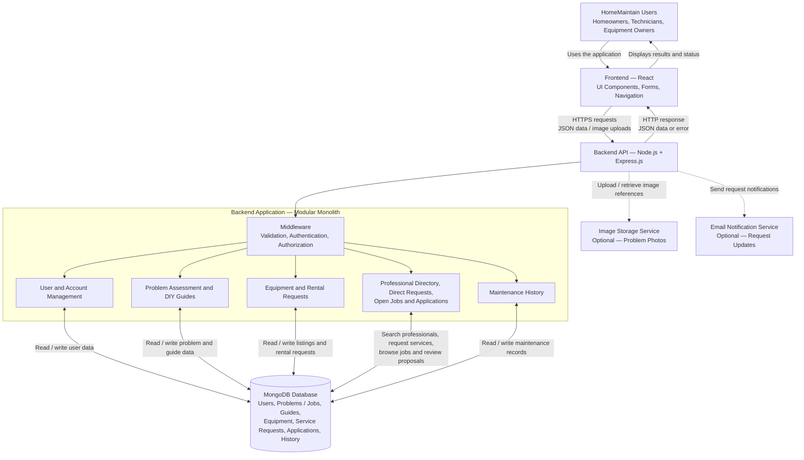

# HomeMaintain — System Architecture

## 1. Purpose

This document describes the proposed high-level architecture of **HomeMaintain**, a web application that helps users resolve household maintenance problems through DIY repair, equipment rental, direct search and service requests to professionals, or open job postings that technicians can apply to with service proposals.

The architecture diagram identifies the main application components, their responsibilities, and the flow of data between them. It is designed for the Minimum Viable Product (MVP), with room for future extensions.

## 2. Technology Stack

HomeMaintain will use the **MERN stack**:

- **MongoDB** — document-oriented database for persistent application data.
- **Express.js** — web framework used to build the REST API.
- **React** — frontend library used to build the user interface.
- **Node.js** — JavaScript runtime for the backend.

Supporting tools and services may include Git for version control, a testing tool such as Postman, and optional external services for image storage and email notifications.

## 3. High-Level Architecture Diagram

**Diagram notes:**

- Solid arrows represent the main application and data interactions.
- Dashed arrows represent optional external services.
- Image storage and email notifications are optional for the initial MVP.
- The frontend communicates with the backend API; it does not connect directly to MongoDB.

## 4. Architectural Style

HomeMaintain will use a **client–server architecture** with three logical layers:

1. **Presentation layer:** React renders the interface and handles user interactions.
2. **Application layer:** Node.js and Express.js expose API endpoints and implement business rules.
3. **Data layer:** MongoDB stores and retrieves application data.

The backend will follow a **modular monolithic architecture**. The application will be deployed as one backend service, with separate modules for users, problems and guides, rentals, professional search and direct service requests, job postings and technician applications, and maintenance history. This keeps the MVP manageable for a solo developer while maintaining separation of responsibilities.

## 5. Component Responsibilities

### 5.1 React Frontend

The frontend provides the screens and interactions represented by the Figma mockups:

- Home — identify a problem.
- Assessment — explore available solutions.
- DIY — follow a repair guide.
- Rentals — browse equipment and submit rental requests.
- Professionals — users search active technician profiles and can send a
  service request directly to a selected professional.
- Jobs — users may also publish maintenance problems; technicians browse open
  jobs and apply with proposals describing the services they can provide.
- Technician workspace — technicians review available jobs and track job
  applications; job owners review proposals and choose a technician.

React sends requests to the backend and displays returned data, loading states, confirmations, and errors.

### 5.2 Node.js and Express.js REST API

The backend receives frontend requests and coordinates application operations. Its responsibilities include:

- Exposing REST API endpoints.
- Validating incoming data.
- Applying business rules.
- Authenticating users and enforcing authorization.
- Reading and writing data through the database layer.
- Returning appropriate HTTP status codes and JSON responses.
- Coordinating optional external services when required.

### 5.3 Backend Modules

| Module | Responsibility |
| --- | --- |
| User and Account Management | Registration, login, profiles, roles, and permissions |
| Problem Assessment and DIY Guides | Maintenance problems, categories, repair guides, and safety information |
| Equipment and Rental Requests | Equipment listings, rental periods, availability checks, and request status |
| Professional Services and Job Marketplace | Professional search, direct service requests, open job listings, technician proposals, application review, and assignment |
| Maintenance History | Records of completed repairs and maintenance activities |

These modules are logical divisions within one backend application, not separate microservices.

### 5.4 MongoDB Database

MongoDB stores the persistent data needed by the application. Initial collections may include:

- `users`
- `problems`
- `maintenanceCategories`
- `diyGuides`
- `equipment`
- `rentalRequests`
- `professionalProfiles`
- `services`
- `serviceRequests`
- `jobApplications`
- `maintenanceRecords`

Users can search `professionalProfiles` and send a direct request stored in
`serviceRequests`. Separately, the `problems` collection can be published as
open jobs; `jobApplications` references those jobs and technician profiles,
storing proposed services and application status. Accepting a proposal assigns
the job and prevents competing applications from being accepted. Direct
service requests and job applications are separate workflows and records. The
final collection structure and references will be refined during database
design. Database access must remain on the backend.

### 5.5 Optional External Services

- **Image storage:** Stores user-uploaded photographs of household problems. The database can store the corresponding file URL or storage key rather than the image binary itself.
- **Email notifications:** Sends updates about rental requests, job applications,
  direct service requests, and job assignment decisions.

These services are optional and may be introduced after the core MVP workflow is working.

## 6. Data Flow

The typical data flow is as follows:

1. **User action:** A user fills out a form or selects an action in the React interface.
2. **Request:** React sends an HTTP request to an Express endpoint. Standard data is exchanged as JSON; image uploads may use multipart form data.
3. **Middleware:** The backend validates the request and checks authentication and permissions where required.
4. **Business logic:** The relevant backend module applies the rules for the requested operation.
5. **Database operation:** The backend reads or updates the relevant MongoDB documents.
6. **Response:** The API returns an HTTP status and a JSON response, or a suitable error response.
7. **UI update:** React displays the result to the user.

### Example workflow: technician applies to an open job

1. A homeowner publishes a problem as an open job.
2. The React client requests open jobs from the API.
3. The backend returns open job postings and relevant details.
4. A technician submits an application with one or more services from their
   profile and a proposal.
5. The backend verifies the active technician profile, validates the proposed
   services, and confirms that the job is still open before storing the
   application.
6. The homeowner reviews applications and accepts one. The backend atomically
   marks the application accepted and the job assigned, and prevents other
   applications from being accepted.
7. Both parties see the updated job/application status. Email notification is
   optional.

### Example workflow: user requests a professional directly

1. A user searches the professional directory by service and optional service
   area.
2. The API returns matching active professional profiles and offered
   services.
3. The user selects a professional and service and submits request details.
4. The backend validates the profile and service and stores a
   `serviceRequests` document.
5. The user and professional can view the request status; optional email
   notification is sent if configured.

For operations that use external services, the backend coordinates the interaction. The browser should never receive database credentials or connect directly to MongoDB.

## 7. Example Data Flow: Publishing a Household Job

For example, a user needs help with a leaking kitchen sink and publishes it for
technicians:

1. The user selects the problem location and category, enters a description, and optionally attaches a photograph.
2. React sends the job details to the proposed `POST /api/jobs` endpoint.
3. Express validates the submitted data and checks the user's authorization.
4. The backend saves the problem record in MongoDB. If image storage is enabled, the backend also coordinates the upload and stores the image reference.
5. The API returns the created problem information and an appropriate HTTP status.
6. React displays the published job and lets the homeowner review technician
   applications when they arrive.

The same request–processing–response pattern applies to rental requests, direct
professional service requests, technician applications, and
maintenance-history operations.

## 8. Scalability, Efficiency, and Security

The architecture supports future growth while keeping the MVP achievable:

- **Modularity:** Feature-based backend modules make code easier to maintain, test, and extend.
- **Efficient data access:** Appropriate MongoDB indexes and carefully designed queries can improve retrieval performance as data grows.
- **Booking consistency:** Rental availability and conflicting requests must be checked on the server. Critical updates may require atomic operations or transactions where appropriate.
- **Security:** Use HTTPS in production, hash passwords with a suitable password-hashing library, validate input, protect secrets with environment variables, and enforce authorization on protected endpoints.
- **Error handling:** Return consistent error responses without exposing internal stack traces or sensitive information.
- **Scalability:** The frontend and backend can be deployed and scaled independently if demand increases. Database capacity and indexing should be monitored as usage grows.
- **Extensibility:** AI-assisted recommendations, online payments, and more advanced notifications can be considered after the core MVP has been implemented and tested.

Scalability depends on implementation, testing, hosting, and data-access patterns; it is not guaranteed by the MERN stack alone.

## 9. Conclusion

The proposed MERN architecture provides a practical foundation for HomeMaintain. React handles the user experience, Node.js and Express.js manage the REST API and business logic, and MongoDB stores application data.

The modular monolithic backend keeps the first version manageable for a solo
developer while allowing the application to evolve. Most importantly, the
architecture supports the core HomeMaintain journey: identify a household
problem, explore possible solutions, choose DIY repair or equipment rental,
search for and directly request a professional, or post an open job for
technicians to apply to. Users can then record completed maintenance
activities.
