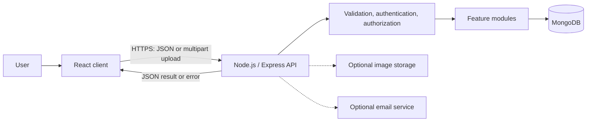
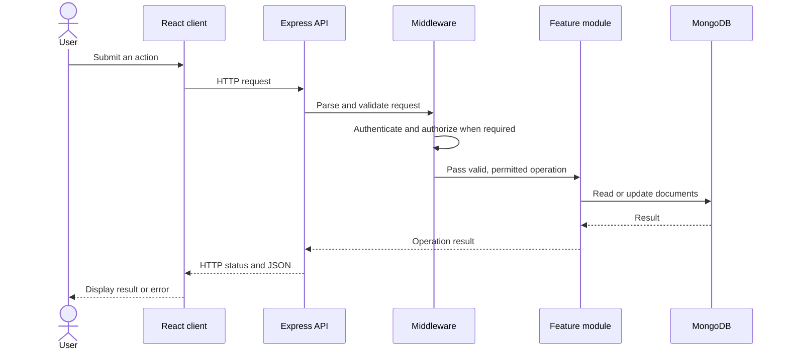

# HomeMaintain Technical Documentation

## Scope and status

This document turns the proposed design in
[SystemArchitecture.md](./SystemArchitecture.md) into a technical overview.
The repository currently contains documentation only: diagrams, routes, and
implementation guidance below describe a planned design, not verified running
services or endpoints.

## Architecture

The planned application uses a React client, a Node.js/Express REST API, and
MongoDB. The backend is a modular monolith: feature modules are separated in
the codebase but run as one backend service. The client communicates with the
API over HTTPS in production; only the backend accesses MongoDB.

The planned feature modules are:

- User and account management
- Problem assessment and DIY guides
- Equipment and rental requests
- Professionals and service requests
- Maintenance history

## Request processing workflow

For optional integrations, the relevant backend operation coordinates the
image-storage or email call. The browser must not call those services with
server credentials.

## Feature workflows

### Problem report

1. Collect problem location, category, and description; optionally collect a
   photo.
2. Submit the fields as JSON, or use multipart form data when uploading a
   photo.
3. Validate the request and apply authentication/authorization policy.
4. Persist the problem and, if enabled, store an image reference.
5. Return the created result and allow the user to continue to assessment.

`POST /api/problems` is an illustrative route in the architecture document,
not a finalized API specification.

### Rental and professional requests

Both request workflows follow the standard request pipeline. For rentals,
server-side availability validation is required before accepting a requested
period. For professional services, validate the selected professional and
service. Persist request status and return it to the client. Exact API
contracts, status values, and transition rules remain to be designed.

## API and error-handling guidelines

- Keep database access in the backend; do not expose credentials or connect
  from the browser directly to MongoDB.
- Validate all client-controlled input on the server. Client-side validation
  is supplementary.
- Authenticate and authorize protected actions in backend middleware or the
  relevant feature service.
- Use HTTPS in production and store secrets in environment configuration, not
  source control.
- Return appropriate HTTP status codes and consistent JSON responses.
- Do not expose stack traces, credentials, or other sensitive internal details
  in error responses.
- Treat the sample endpoint and data shapes as provisional until an API
  contract is agreed.

## Data and integration guidelines

The architecture proposes MongoDB collections for users, problems,
maintenance categories, DIY guides, equipment, rental requests, professional
profiles, service requests, and maintenance records. The final schema,
references, indexes, and retention policies must be established during
implementation.

Store image references (such as a URL or storage key) in database records
rather than image binaries when using an external image-storage service.
Image storage and email notifications are optional integrations; the core MVP
should not depend on them unless the scope is explicitly changed.

Check availability and prevent conflicting rental requests on the server.
Use atomic updates or transactions where needed to preserve consistency under
concurrent requests.

## Testing and implementation guidance

- Keep feature responsibilities separate within the modular monolith.
- Test validation, authorization, and failure paths as well as successful
  requests.
- Test rental availability with overlapping and concurrent requests.
- Keep external services behind backend integrations so they can be disabled
  or tested independently.
- Treat API and database changes as coordinated changes across the client,
  backend, and documentation.

For the proposed components and security considerations, see
[SystemArchitecture.md](./SystemArchitecture.md). For reference collections
and implementation checklists, see
[ARCHITECTURE_REFERENCE.md](./ARCHITECTURE_REFERENCE.md).
