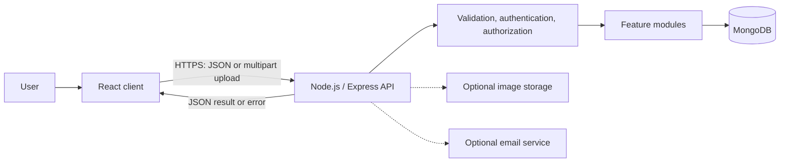
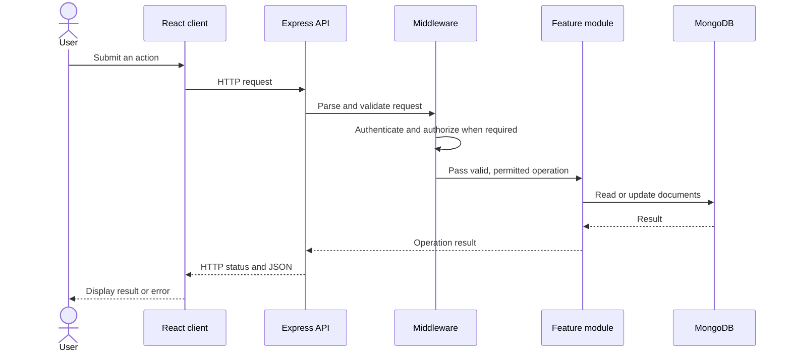
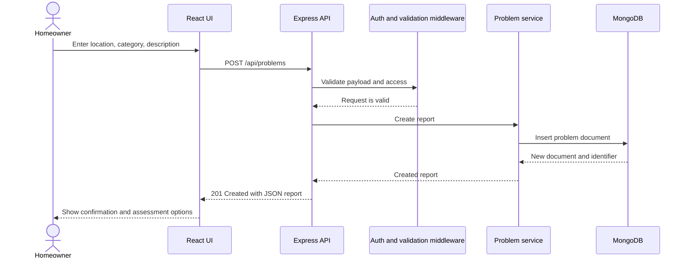
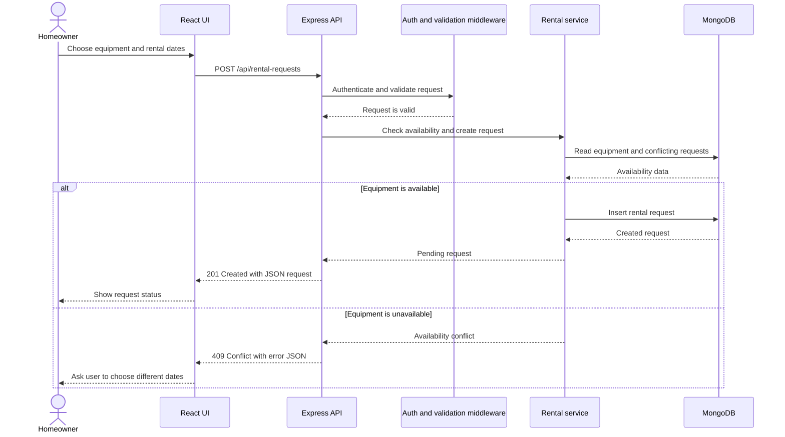
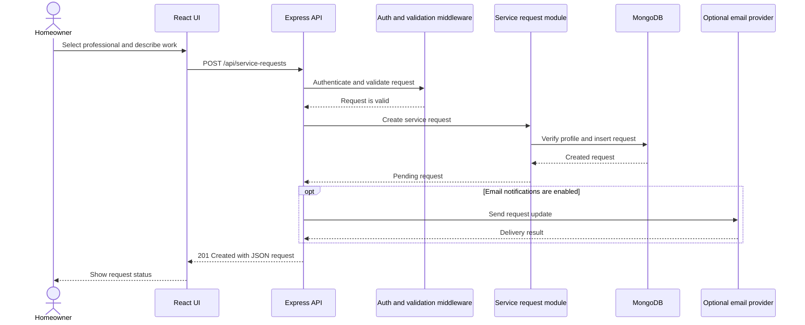

# HomeMaintain Technical Documentation

## Scope and status

This document turns the proposed design in
[SystemArchitecture.md](./SystemArchitecture.md) into a technical overview.
The repository currently contains documentation only: diagrams, routes, and
implementation guidance below describe a planned design, not verified running
services or endpoints.

## Architecture

The planned application uses a React client, a Node.js/Express REST API, and
MongoDB. The backend is a modular monolith: feature modules are separated in
the codebase but run as one backend service. The client communicates with the
API over HTTPS in production; only the backend accesses MongoDB.



The planned feature modules are:

- User and account management
- Problem assessment and DIY guides
- Equipment and rental requests
- Professionals and service requests
- Maintenance history

## Front-end components and interactions

The React component names below are a suggested decomposition of the proposed
screens. They are not existing components in this documentation-only
repository.

| UI component / screen | Main responsibilities and interactions |
| --- | --- |
| `App` and `AppLayout` | Configure routes, shared page layout, navigation, loading/error boundaries, and session state. |
| `HomePage` / `ProblemReportForm` | Collect problem location, category, description, and optional photo; submit to `POST /api/problems`; show validation feedback and the created report. |
| `AssessmentPage` / `SolutionOptions` | Load the selected problem and present the available DIY, rental, and professional paths. Link to relevant guides, equipment, and professionals. |
| `GuideList` / `GuideViewer` | Request guides, render steps and safety notes, and let the user return to the assessment. |
| `EquipmentList` / `RentalRequestForm` | Browse equipment; collect start/end dates; request availability-filtered listings; submit a rental request; display pending or conflict results. |
| `ProfessionalDirectory` / `ServiceRequestForm` | Browse professionals and services; collect request details; submit the selected professional/service request and display its status. |
| `MaintenanceHistoryPage` / `MaintenanceRecordForm` | Retrieve the user's records and submit a completed-maintenance record; show saved entries and API errors. |
| `AuthForms` | Register or sign in if account flows are included in MVP; keep credentials and tokens out of logs and present authentication errors safely. |
| Shared `FormField`, `StatusNotice`, and `LoadingState` | Reuse accessible form controls, field-level errors, request progress, success confirmation, and recoverable failure messaging. |

Components should call a shared API client rather than issue ad-hoc requests
from presentation code. Forms may provide immediate client-side feedback, but
the server remains authoritative for validation, access checks, and rental
availability. Exact route protection and sign-in requirements are product
decisions to confirm.

## Request processing workflow



For optional integrations, the relevant backend operation coordinates the
image-storage or email call. The browser must not call those services with
server credentials.

## Feature workflows

### Problem report

1. Collect problem location, category, and description; optionally collect a
   photo.
2. Submit the fields as JSON, or use multipart form data when uploading a
   photo.
3. Validate the request and apply authentication/authorization policy.
4. Persist the problem and, if enabled, store an image reference.
5. Return the created result and allow the user to continue to assessment.

`POST /api/problems` is an illustrative route in the architecture document,
not a finalized API specification.

### Rental and professional requests

Both request workflows follow the standard request pipeline. For rentals,
server-side availability validation is required before accepting a requested
period. For professional services, validate the selected professional and
service. Persist request status and return it to the client. Exact API
contracts, status values, and transition rules remain to be designed.

## API and error-handling guidelines

- Keep database access in the backend; do not expose credentials or connect
  from the browser directly to MongoDB.
- Validate all client-controlled input on the server. Client-side validation
  is supplementary.
- Authenticate and authorize protected actions in backend middleware or the
  relevant feature service.
- Use HTTPS in production and store secrets in environment configuration, not
  source control.
- Return appropriate HTTP status codes and consistent JSON responses.
- Do not expose stack traces, credentials, or other sensitive internal details
  in error responses.
- Treat the sample endpoint and data shapes as provisional until an API
  contract is agreed.

## Data and integration guidelines

The architecture proposes MongoDB collections for users, problems,
maintenance categories, DIY guides, equipment, rental requests, professional
profiles, service requests, and maintenance records. The final schema,
references, indexes, and retention policies must be established during
implementation.

Store image references (such as a URL or storage key) in database records
rather than image binaries when using an external image-storage service.
Image storage and email notifications are optional integrations; the core MVP
should not depend on them unless the scope is explicitly changed.

Check availability and prevent conflicting rental requests on the server.
Use atomic updates or transactions where needed to preserve consistency under
concurrent requests.

## Testing and implementation guidance

- Keep feature responsibilities separate within the modular monolith.
- Test validation, authorization, and failure paths as well as successful
  requests.
- Test rental availability with overlapping and concurrent requests.
- Keep external services behind backend integrations so they can be disabled
  or tested independently.
- Treat API and database changes as coordinated changes across the client,
  backend, and documentation.

For the proposed components and security considerations, see
[SystemArchitecture.md](./SystemArchitecture.md). For reference collections
and implementation checklists, see
[ARCHITECTURE_REFERENCE.md](./ARCHITECTURE_REFERENCE.md).

## Component and class descriptions

The following classes are a proposed domain design for the Node.js/Express
backend. They describe responsibilities and likely fields, not existing source
code. IDs are MongoDB `ObjectId` values represented as strings in API payloads.
Methods describe behavior and should be implemented in domain services or
repositories as appropriate, rather than placing persistence logic in every
model.

| Class | Key attributes | Key methods / responsibility |
| --- | --- | --- |
| `User` | `id`, `name`, `email`, `passwordHash`, `role`, `createdAt`, `updatedAt` | `verifyPassword(password)`, `can(action, resource)`; represents an account and its access role. Never return `passwordHash` to clients. |
| `ProblemReport` | `id`, `reporterId`, `location`, `categoryId`, `description`, `photoKeys[]`, `status`, `createdAt`, `updatedAt` | `validate()`, `addPhoto(key)`, `changeStatus(status)`; records a household problem. |
| `MaintenanceCategory` | `id`, `name`, `description`, `parentId?` | `validate()`; classifies problems and guides. |
| `DiyGuide` | `id`, `categoryId`, `title`, `summary`, `steps[]`, `safetyNotes[]`, `published`, `updatedAt` | `validate()`, `isApplicableTo(categoryId)`; provides reviewed repair instructions. |
| `Equipment` | `id`, `ownerId`, `name`, `description`, `categoryId`, `pricePerDay?`, `active`, `createdAt`, `updatedAt` | `validate()`, `isAvailable(from, to)`; describes an item that may be rented. Availability must be checked against accepted requests by the server. |
| `RentalRequest` | `id`, `renterId`, `equipmentId`, `startAt`, `endAt`, `status`, `createdAt`, `updatedAt` | `validatePeriod()`, `canTransitionTo(status)`, `overlaps(from, to)`; records a rental request. Statuses are **Confirm**. |
| `ProfessionalProfile` | `id`, `userId`, `displayName`, `serviceIds[]`, `description`, `active`, `createdAt`, `updatedAt` | `offers(serviceId)`, `validate()`; describes a professional and services offered. |
| `ServiceRequest` | `id`, `customerId`, `professionalId`, `serviceId`, `problemId?`, `requestedAt?`, `details`, `status`, `createdAt`, `updatedAt` | `validate()`, `canTransitionTo(status)`; records a request for professional assistance. |
| `MaintenanceRecord` | `id`, `ownerId`, `problemId?`, `summary`, `completedAt`, `performedBy?`, `createdAt` | `validate()`, `isVisibleTo(user)`; records completed work and applies its access policy. |

The proposed service layer may expose `ProblemService.createReport`,
`RentalService.createRequest` / `checkAvailability`,
`ServiceRequestService.createRequest`, and
`MaintenanceService.createRecord`. These operations enforce business rules
before repositories persist data. Availability checks and writes must be
protected against concurrent conflicting requests.

## Proposed MongoDB document structures

All documents use MongoDB `_id` as their primary identifier. Foreign keys are
stored as ObjectId references; API responses serialize identifiers as strings.
Unless stated otherwise, `createdAt` and `updatedAt` are server-managed dates.
The field requirements below are a proposed MVP baseline and must be reconciled
with product decisions before implementation.

| Collection | Mandatory fields | Optional fields | Example document |
| --- | --- | --- | --- |
| `users` | `name`, `email`, `passwordHash`, `role`, `createdAt`, `updatedAt` | `phone`, `avatarKey` | `{ "_id": "ObjectId", "name": "Amina", "email": "amina@example.test", "passwordHash": "<hash>", "role": "homeowner", "createdAt": "ISODate", "updatedAt": "ISODate" }` |
| `problems` | `reporterId`, `location`, `categoryId`, `description`, `status`, `createdAt`, `updatedAt` | `photoKeys[]` | `{ "_id": "ObjectId", "reporterId": "ObjectId", "location": "kitchen", "categoryId": "ObjectId", "description": "Leaking sink", "photoKeys": [], "status": "open", "createdAt": "ISODate", "updatedAt": "ISODate" }` |
| `maintenanceCategories` | `name`, `createdAt`, `updatedAt` | `description`, `parentId` | `{ "_id": "ObjectId", "name": "Plumbing", "description": "Water systems", "createdAt": "ISODate", "updatedAt": "ISODate" }` |
| `diyGuides` | `categoryId`, `title`, `summary`, `steps[]`, `safetyNotes[]`, `published`, `createdAt`, `updatedAt` | `estimatedMinutes`, `requiredTools[]` | `{ "_id": "ObjectId", "categoryId": "ObjectId", "title": "Inspect a sink leak", "summary": "Basic checks", "steps": ["Turn off water", "Inspect connections"], "safetyNotes": ["Stop if electrical hazards are present"], "published": true, "createdAt": "ISODate", "updatedAt": "ISODate" }` |
| `equipment` | `ownerId`, `name`, `description`, `categoryId`, `active`, `createdAt`, `updatedAt` | `pricePerDay`, `photoKey` | `{ "_id": "ObjectId", "ownerId": "ObjectId", "name": "Pipe wrench", "description": "Adjustable wrench", "categoryId": "ObjectId", "active": true, "createdAt": "ISODate", "updatedAt": "ISODate" }` |
| `rentalRequests` | `renterId`, `equipmentId`, `startAt`, `endAt`, `status`, `createdAt`, `updatedAt` | `message`, `quotedTotal` | `{ "_id": "ObjectId", "renterId": "ObjectId", "equipmentId": "ObjectId", "startAt": "ISODate", "endAt": "ISODate", "status": "pending", "createdAt": "ISODate", "updatedAt": "ISODate" }` |
| `professionalProfiles` | `userId`, `displayName`, `serviceIds[]`, `description`, `active`, `createdAt`, `updatedAt` | `serviceArea`, `photoKey` | `{ "_id": "ObjectId", "userId": "ObjectId", "displayName": "Sam the Plumber", "serviceIds": ["ObjectId"], "description": "Residential plumbing", "active": true, "createdAt": "ISODate", "updatedAt": "ISODate" }` |
| `serviceRequests` | `customerId`, `professionalId`, `serviceId`, `details`, `status`, `createdAt`, `updatedAt` | `problemId`, `requestedAt` | `{ "_id": "ObjectId", "customerId": "ObjectId", "professionalId": "ObjectId", "serviceId": "ObjectId", "details": "Please inspect a sink leak", "status": "pending", "createdAt": "ISODate", "updatedAt": "ISODate" }` |
| `maintenanceRecords` | `ownerId`, `summary`, `completedAt`, `createdAt` | `problemId`, `performedBy` | `{ "_id": "ObjectId", "ownerId": "ObjectId", "summary": "Replaced sink washer", "completedAt": "ISODate", "createdAt": "ISODate" }` |

Email addresses should have a uniqueness constraint. Add indexes for fields
used to look up ownership and references (for example `reporterId`,
`equipmentId`, `professionalId`, and `categoryId`). The final indexing strategy,
retention rules, role values, and request status values remain design decisions.
Do not persist image binaries in these documents; store a storage key or
equivalent reference if photo upload is enabled.

## High-level sequence diagrams

The following diagrams show planned interactions. Error paths are represented
at a high level; exact status codes and response schemas are specified in the
API section below.

### Submit a problem report



### Request equipment rental



### Request professional assistance



## Internal API

All routes below are proposed JSON API contracts, not implemented endpoints.
The base path is `/api`; production traffic uses HTTPS. JSON request bodies
should use `Content-Type: application/json`. IDs are strings in requests and
responses. Protected routes require the agreed authentication mechanism; the
`Bearer` example below is a proposal, not a finalized choice.

| Method and path | Access | Input | Success response |
| --- | --- | --- | --- |
| `POST /api/auth/register` | Public | JSON: `{ "name", "email", "password" }` | `201`: `{ "data": { "id", "name", "email", "role" } }` |
| `POST /api/auth/login` | Public | JSON: `{ "email", "password" }` | `200`: `{ "data": { "accessToken", "user": { "id", "name", "email", "role" } } }`; token design **Confirm**. |
| `POST /api/problems` | Access policy **Confirm** | JSON: `{ "location", "categoryId", "description" }`; if photo upload is enabled, use multipart form data with a `photo` file field and the same text fields | `201`: `{ "data": { "id", "location", "categoryId", "description", "photoKeys", "status", "createdAt" } }`; storage references are assigned by the backend. |
| `GET /api/problems/:problemId` | Owner/access policy **Confirm** | Path parameter `problemId` | `200`: `{ "data": { "id", "location", "categoryId", "description", "photoKeys", "status", "createdAt" } }` |
| `GET /api/guides?categoryId={id}` | Public/read policy **Confirm** | Optional query parameter `categoryId` | `200`: `{ "data": [{ "id", "categoryId", "title", "summary", "steps", "safetyNotes" }] }` |
| `GET /api/equipment?categoryId={id}&startAt={date}&endAt={date}` | Public/read policy **Confirm** | Optional query parameters; ISO-8601 dates when availability filtering is requested | `200`: `{ "data": [{ "id", "name", "description", "categoryId", "active" }] }` |
| `POST /api/rental-requests` | Authenticated | JSON: `{ "equipmentId", "startAt", "endAt", "message"? }` | `201`: `{ "data": { "id", "equipmentId", "startAt", "endAt", "status", "createdAt" } }`; unavailable period returns `409`. |
| `GET /api/professionals?serviceId={id}` | Public/read policy **Confirm** | Optional query parameter `serviceId` | `200`: `{ "data": [{ "id", "displayName", "serviceIds", "description", "serviceArea"? }] }` |
| `POST /api/service-requests` | Authenticated | JSON: `{ "professionalId", "serviceId", "problemId"?, "requestedAt"?, "details" }` | `201`: `{ "data": { "id", "professionalId", "serviceId", "status", "createdAt" } }` |
| `POST /api/maintenance-records` | Authenticated | JSON: `{ "problemId"?, "summary", "completedAt", "performedBy"? }` | `201`: `{ "data": { "id", "problemId"?, "summary", "completedAt", "createdAt" } }` |
| `GET /api/maintenance-records` | Authenticated; owner scoping required | Optional query parameters to be defined | `200`: `{ "data": [{ "id", "problemId"?, "summary", "completedAt" }] }` |

For list endpoints, pagination parameters (`limit`, `cursor` or `page`) should
be agreed before implementation. Dates use ISO-8601 strings at the API
boundary. A consistent error body is proposed:

```json
{
  "error": {
    "code": "VALIDATION_ERROR",
    "message": "The request contains invalid fields.",
    "fields": {
      "endAt": "Must be later than startAt."
    }
  }
}
```

Use appropriate status codes: `400` for malformed input, `401` for missing or
invalid authentication, `403` for insufficient permissions, `404` for unknown
resources, `409` for availability conflicts, and `500` for unexpected server
errors. Error messages must not expose stack traces or secrets.

## External APIs and services

No specific external API provider is selected in the architecture proposal.
The following integrations are optional candidates, not current dependencies
or confirmed selections:

| Integration | Need and selection rationale | Status / boundary |
| --- | --- | --- |
| Image/object storage API | Store problem photos without placing image binaries in MongoDB. Select a provider that supports private objects, access controls, secure upload/download, and acceptable cost and retention controls. | Optional; provider and upload flow **Confirm**. The backend mediates access and stores only an object key or safe reference. |
| Email delivery API | Notify users about rental or professional-service request updates. Select a provider with delivery reporting, secure credentials, and suitable operational cost. | Optional; provider and notification events **Confirm**. Invoke from backend only. |

There is no payment, maps, AI, or third-party authentication API specified for
the MVP. Do not add a provider or claim an integration is in use until it has
been selected and documented.

## SCM strategy

Use Git as the source-control system and keep the default `main` branch
releasable.

- Create short-lived branches named `feature/<topic>`, `fix/<topic>`, or
  `docs/<topic>` from `development`.
- Open a pull request from each work branch to `development`; include a concise
  summary, related issue/task, and test evidence.
- Require a clean automated check run and review before merging. For solo
  development, use a self-review checklist and do not merge with failing
  checks.
- Merge tested changes from `development` to `main` through a release pull
  request; tag production releases.
- Commit coherent changes regularly with descriptive messages. Never commit
  credentials, generated secrets, or environment-specific configuration.
- Keep documentation updated in the same change when API, data, workflow, or
  deployment behavior changes.

## QA and deployment strategy

The tools below are recommendations for the planned JavaScript/MERN
implementation; the current documentation-only repository does not yet declare
or configure these tools.

| Test stage | Strategy | Suggested tool |
| --- | --- | --- |
| Unit | Test validation, domain rules, permission checks, and service behavior in isolation. | Jest |
| Integration | Test Express routes against a test database, including error responses and access controls. | Jest with an isolated MongoDB test instance |
| API/manual | Exercise request and response contracts and critical workflows. | Postman |
| UI | Test form validation, navigation, loading/error states, and user-visible outcomes. | React Testing Library with Jest |
| End-to-end | Verify problem reporting, rental request, and professional request through the browser and API. | Browser automation tool to be selected |

Prioritize invalid-input, unauthorized-access, and failure-path tests as well as
happy paths. Include tests for overlapping and concurrent rental periods to
verify that two conflicting requests cannot both be accepted.

Proposed deployment pipeline:

1. On pull requests, install locked dependencies, run formatting/lint checks,
   unit and integration tests, and build the client and server.
2. Merge approved changes into `development` and deploy to staging using
   staging-only configuration and data.
3. Run smoke tests and manually verify the critical user journeys in staging.
4. Promote an approved release from `main` to production, with production
   secrets supplied by the deployment environment.
5. Verify health and critical endpoints after deployment and retain a rollback
   path to the previous release.

The CI provider, hosting platform, environment configuration, and exact
deployment gates remain to be selected. Production deployment must not run
with development credentials or test data.
