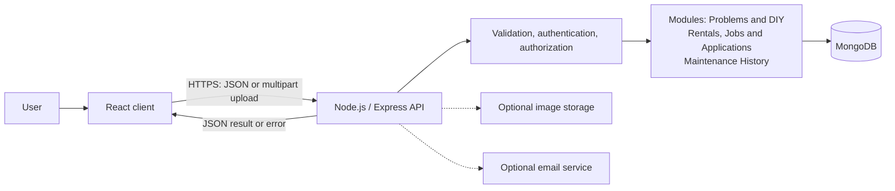
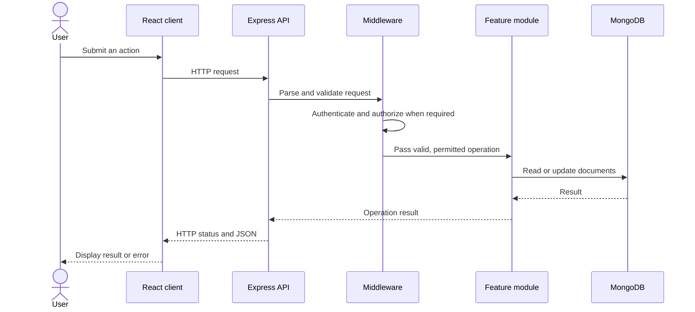
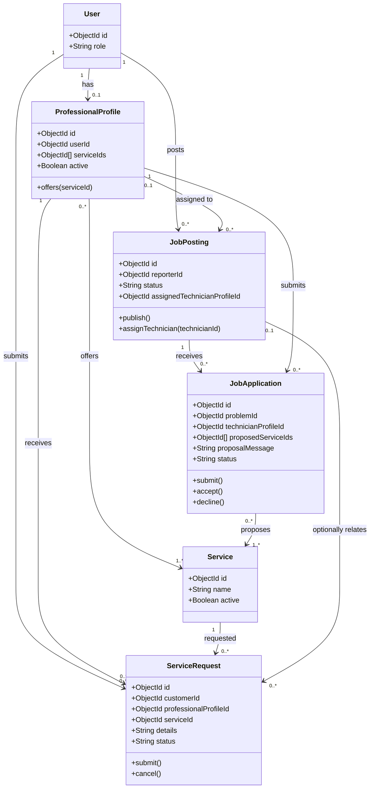
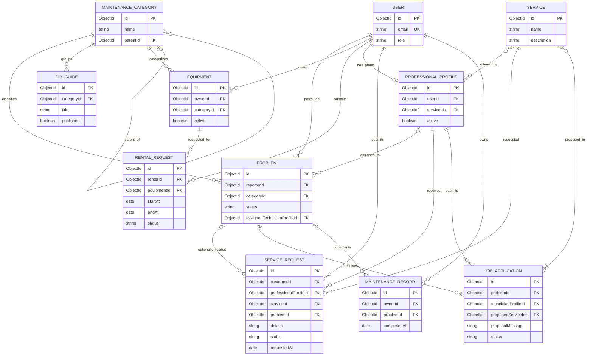
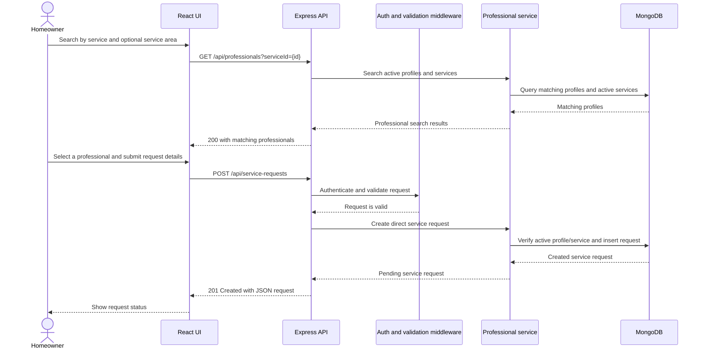
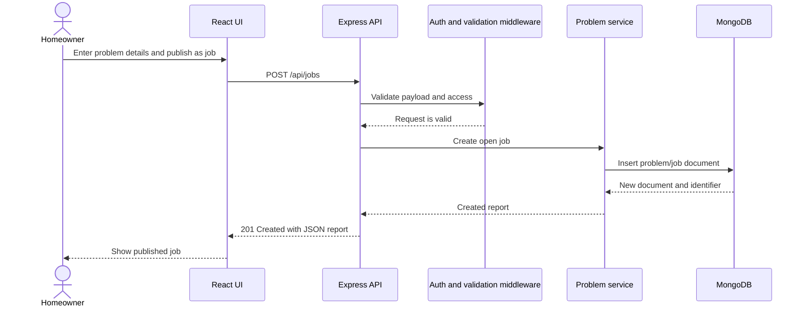
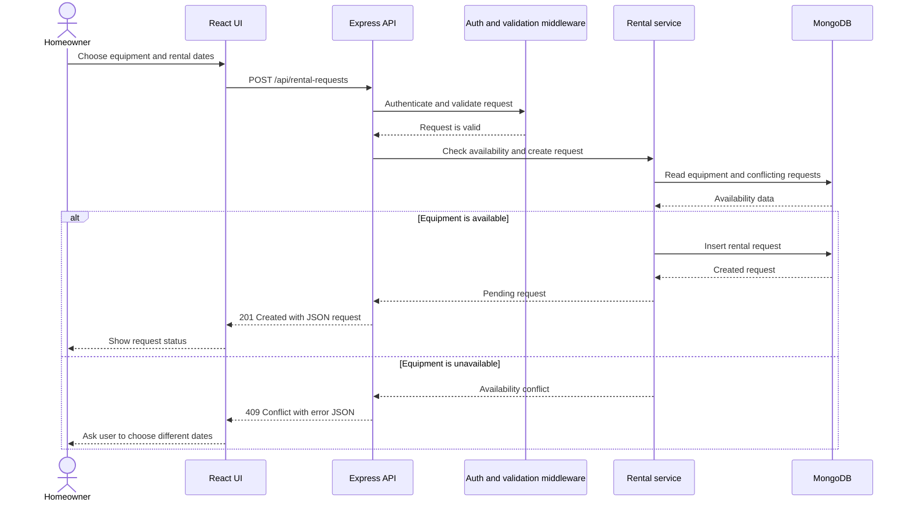
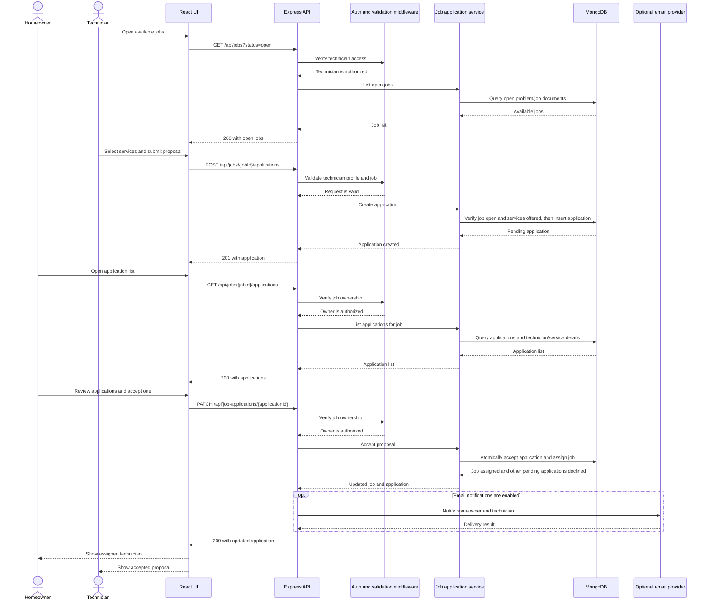

# HomeMaintain Technical Documentation

## Scope and status

This document turns the proposed design in
[SystemArchitecture.md](./SystemArchitecture.md) into a technical overview.
The backend currently implements account authentication, user profile
management, admin user management, a seeded service catalog, technician
profiles, Tunisia governorates, and job creation, matching, applications,
assignment, detail, update, and paginated open-job listing endpoints.
The service catalog retains its existing database collection name and IDs.
MongoDB indexes enforce service references and duplicate-open-job prevention.
Other routes, frontend components, and workflows below remain proposed until
implemented.

## Architecture

The planned application uses a React client, a Node.js/Express REST API, and
MongoDB. The backend is a modular monolith: feature modules are separated in
the codebase but run as one backend service. The client communicates with the
API over HTTPS in production; only the backend accesses MongoDB.



The planned feature modules are:

- User and account management
- Problem assessment and DIY guides
- Equipment and rental requests
- Professional directory and direct service requests
- Open job postings and technician applications
- Maintenance history

## Front-end components and interactions

The React component names below are a suggested decomposition of the proposed
screens. They are not existing components in this documentation-only
repository.

| UI component / screen | Main responsibilities and interactions |
| --- | --- |
| `App` and `AppLayout` | Configure routes, shared page layout, navigation, loading/error boundaries, and session state. |
| `HomePage` / `JobPostingForm` | Collect problem location, service, description, and optional photo; publish through `POST /api/jobs`; show validation feedback and the open job. |
| `AssessmentPage` / `SolutionOptions` | Load the selected problem and present DIY, rental, direct professional search/request, and job-posting paths. Link to relevant guides, equipment, and the user's service-request or job/application view. |
| `GuideList` / `GuideViewer` | Request guides, render steps and safety notes, and let the user return to the assessment. |
| `EquipmentList` / `RentalRequestForm` | Browse equipment; collect start/end dates; request availability-filtered listings; submit a rental request; display pending or conflict results. |
| `ProfessionalDirectory` / `ProfessionalSearch` | Search active professional profiles by service and optional service area; display matching professionals and offered services. |
| `ProfessionalProfileView` / `ServiceRequestForm` | Show a selected professional's details; collect service and request details; submit a direct service request and display its status. |
| `AvailableJobsPage` / `JobList` | Let authenticated technicians browse jobs whose status is open; filter by service and governorate. |
| `JobApplicationForm` | Let an eligible technician submit a proposal for a matching open job. |
| `JobApplicationsPage` / `ApplicationReview` | Let the job owner review proposals or browse matching technicians and assign one directly. |
| `MaintenanceHistoryPage` / `MaintenanceRecordForm` | Retrieve the user's records and submit a completed-maintenance record; show saved entries and API errors. |
| `AuthForms` | Register or sign in if account flows are included in MVP; keep credentials and tokens out of logs and present authentication errors safely. |
| Shared `FormField`, `StatusNotice`, and `LoadingState` | Reuse accessible form controls, field-level errors, request progress, success confirmation, and recoverable failure messaging. |

Components should call a shared API client rather than issue ad-hoc requests
from presentation code. Forms may provide immediate client-side feedback, but
the server remains authoritative for validation, access checks, and rental
availability. Only technicians should see and apply to available jobs; only
the job owner may review applications and accept a proposal. A user-selected
professional receives a separate direct service request. Exact route
protection and sign-in requirements should be confirmed.

## Request processing workflow



For optional integrations, the relevant backend operation coordinates the
image-storage or email call. The browser must not call those services with
server credentials.

## Feature workflows

### Publish a maintenance job

1. Select the home’s location from Tunisia’s supported governorates, then enter
   the maintenance problem, service, and description; optionally add a photo.
2. Submit the fields as JSON, or use multipart form data when uploading a
   photo.
3. Validate the request and apply authentication/authorization policy.
4. Persist the problem and, if enabled, store an image reference.
5. Return the created open job and allow the homeowner to browse matching
   technicians or review incoming applications.

`GET /api/governorates` returns the supported Tunisian locations for the job
form, and `GET /api/services` returns the active service catalog.
`POST /api/jobs` stores the selected service ID and governorate ID and creates
an open job.

### Rental requests and technician applications

For rentals, server-side availability validation is required before accepting a
requested period. For technician applications, validate that the job is open
and the applicant's active profile offers its service in the job's governorate.
Homeowners can also browse profiles matching that same service and location,
then assign one directly. Both acceptance and direct assignment use a
conditional open-to-assigned update so only one technician can win the job.

### Search for a professional and request service directly

1. The user searches active professional profiles by service and optional
   service area.
2. The API returns matching profiles with their active offered services.
3. The user selects a professional and service, enters request details, and
   submits a direct service request.
4. The backend validates that the profile and service are active and
   associated, then stores a `serviceRequests` document linked to the user,
   professional profile, and service.
5. The user and professional can view the request and its status. This path
   does not publish an open job or create a `jobApplications` record.

## API and error-handling guidelines

- Keep database access in the backend; do not expose credentials or connect
  from the browser directly to MongoDB.
- Validate all client-controlled input on the server. Client-side validation
  is supplementary.
- Authenticate and authorize protected actions in backend middleware or the
  relevant feature service.
- Use HTTPS in production and store secrets in environment configuration, not
  source control.
- Return appropriate HTTP status codes and consistent JSON responses.
- Do not expose stack traces, credentials, or other sensitive internal details
  in error responses.
- Treat the sample endpoint and data shapes as provisional until an API
  contract is agreed.

## Data and integration guidelines

The architecture proposes MongoDB collections for users, problems/jobs,
maintenance categories, DIY guides, equipment, rental requests, professional
profiles, services, service requests, job applications, and maintenance
records. The final schema, references, indexes, and retention policies must be
established during implementation.

Store image references (such as a URL or storage key) in database records
rather than image binaries when using an external image-storage service.
Image storage and email notifications are optional integrations; the core MVP
should not depend on them unless the scope is explicitly changed.

Check availability and prevent conflicting rental requests on the server.
Use atomic updates or transactions where needed to preserve consistency under
concurrent requests.

## Testing and implementation guidance

- Keep feature responsibilities separate within the modular monolith.
- Test validation, authorization, and failure paths as well as successful
  requests.
- Test job listing visibility, technician eligibility, proposal service
  membership, and owner-only application review.
- Test competing application acceptance to ensure only one proposal can be
  accepted for a job.
- Test rental availability with overlapping and concurrent requests.
- Keep external services behind backend integrations so they can be disabled
  or tested independently.
- Treat API and database changes as coordinated changes across the client,
  backend, and documentation.

For the proposed components and security considerations, see
[SystemArchitecture.md](./SystemArchitecture.md). For reference collections
and implementation checklists, see
[ARCHITECTURE_REFERENCE.md](./ARCHITECTURE_REFERENCE.md).

## Component and class descriptions

The following classes are a proposed domain design for the Node.js/Express
backend. They describe responsibilities and likely fields, not existing source
code. IDs are MongoDB `ObjectId` values represented as strings in API payloads.
Methods describe behavior and should be implemented in domain services or
repositories as appropriate, rather than placing persistence logic in every
model.

| Class | Key attributes | Key methods / responsibility |
| --- | --- | --- |
| `User` | `id`, `name`, `email`, `passwordHash`, `role`, `createdAt`, `updatedAt` | `verifyPassword(password)`, `can(action, resource)`; represents an account and its access role. Never return `passwordHash` to clients. |
| `JobPosting` | `id`, `reporterId`, `title`, `location` (governorate ID), `serviceId`, `assignedTechnicianProfileId?`, `description`, `status`, `createdAt`, `updatedAt` | Stored in `problems`; service and location jointly define technician matching; only open postings accept applications or direct assignments. |
| `Service` | `id`, `name`, `description`, `slug`, `active`, `createdAt`, `updatedAt` | Stored in the legacy `jobCategories` collection to preserve existing service IDs; `/api/services` is the canonical API and `/api/job-categories` is a compatibility alias. |
| `MaintenanceCategory` | `id`, `name`, `description`, `parentId?` | `validate()`; classifies problems and guides. |
| `DiyGuide` | `id`, `categoryId`, `title`, `summary`, `steps[]`, `safetyNotes[]`, `published`, `updatedAt` | `validate()`, `isApplicableTo(categoryId)`; provides reviewed repair instructions. |
| `Equipment` | `id`, `ownerId`, `name`, `description`, `categoryId`, `pricePerDay?`, `active`, `createdAt`, `updatedAt` | `validate()`, `isAvailable(from, to)`; describes an item that may be rented. Availability must be checked against accepted requests by the server. |
| `RentalRequest` | `id`, `renterId`, `equipmentId`, `startAt`, `endAt`, `status`, `createdAt`, `updatedAt` | `validatePeriod()`, `canTransitionTo(status)`, `overlaps(from, to)`; records a rental request. Statuses are **Confirm**. |
| `TechnicianProfile` | `id`, `userId`, `displayName`, `description`, `active`, `offerings[]` (`serviceId`, `governorates[]`) | One profile per technician; each active catalog service is offered only in its declared governorates. |
| `ServiceRequest` | `id`, `customerId`, `professionalProfileId`, `serviceId`, `problemId?`, `details`, `status`, `requestedAt?`, `createdAt`, `updatedAt` | `validate()`, `canTransitionTo(status)`, `cancel()`; records a user's direct request to a selected professional, separate from job applications. |
| `JobApplication` | `id`, `jobId`, `technicianProfileId`, `proposalMessage`, `status`, `createdAt`, `updatedAt` | Unique per job and technician profile; technicians can apply only when their active profile offers the job's service in its governorate. Homeowners may accept or decline. |
| `MaintenanceRecord` | `id`, `ownerId`, `problemId?`, `summary`, `completedAt`, `performedBy?`, `createdAt` | `validate()`, `isVisibleTo(user)`; records completed work and applies its access policy. |

### Professional service and job marketplace class diagram

This conceptual UML view shows both independent professional workflows:
direct requests from users and technician applications to open jobs. It
complements the field-level class table above and the MongoDB collection
diagram below.



The proposed service layer may expose `ProblemService.createReport` /
`publishAsJob`, `ProfessionalSearchService.search`, `ServiceRequestService.create` /
`review`, `JobService.listOpenJobs`, `JobApplicationService.apply` /
`review` / `accept`, `RentalService.createRequest` /
`checkAvailability`, and `MaintenanceService.createRecord`. These operations
enforce business rules before repositories persist data. Job acceptance and
related status changes must be atomic so concurrent reviews cannot assign the
same job to multiple technicians.

## Proposed MongoDB document structures

All documents use MongoDB `_id` as their primary identifier. Foreign keys are
stored as ObjectId references; API responses serialize identifiers as strings.
Unless stated otherwise, `createdAt` and `updatedAt` are server-managed dates.
The field requirements below are a proposed MVP baseline and must be reconciled
with product decisions before implementation. A technician account must have
an active professional profile with at least one active service to apply.

| Collection | Mandatory fields | Optional fields | Example document |
| --- | --- | --- | --- |
| `users` | `name`, `email`, `passwordHash`, `role`, `createdAt`, `updatedAt` | `phone`, `avatarKey` | `{ "_id": "ObjectId", "name": "Amina", "email": "amina@example.test", "passwordHash": "<hash>", "role": "homeowner", "createdAt": "ISODate", "updatedAt": "ISODate" }`; technician accounts use the `technician` role. |
| `problems` (also job postings) | `reporterId`, `title`, `location` (one of the 24 governorate IDs), `serviceId`, `description`, `status`, `duplicateFingerprint`, `createdAt`, `updatedAt` | `assignedTechnicianProfileId`, `scheduledDate`, `scheduledSlot`, `homeownerRating`, `technicianRating` | `{ "_id": "ObjectId", "reporterId": "ObjectId", "title": "Leaking kitchen sink", "location": "tunis", "serviceId": "ObjectId", "description": "Water is leaking under the sink", "status": "open", "duplicateFingerprint": "<sha256>", "createdAt": "ISODate", "updatedAt": "ISODate" }`; `serviceId` references a service in `jobCategories`; the fingerprint is internal and excluded from normal query results. |
| `jobCategories` (legacy collection name for the service catalog) | `name`, `description`, `slug`, `active`, `createdAt`, `updatedAt` | — | Service records use their `_id` values in jobs and technician offerings; the collection name is retained for data compatibility. |
| `maintenanceCategories` | `name`, `createdAt`, `updatedAt` | `description`, `parentId` | `{ "_id": "ObjectId", "name": "Plumbing", "description": "Water systems", "createdAt": "ISODate", "updatedAt": "ISODate" }` |
| `diyGuides` | `categoryId`, `title`, `summary`, `steps[]`, `safetyNotes[]`, `published`, `createdAt`, `updatedAt` | `estimatedMinutes`, `requiredTools[]` | `{ "_id": "ObjectId", "categoryId": "ObjectId", "title": "Inspect a sink leak", "summary": "Basic checks", "steps": ["Turn off water", "Inspect connections"], "safetyNotes": ["Stop if electrical hazards are present"], "published": true, "createdAt": "ISODate", "updatedAt": "ISODate" }` |
| `equipment` | `ownerId`, `name`, `description`, `categoryId`, `active`, `createdAt`, `updatedAt` | `pricePerDay`, `photoKey` | `{ "_id": "ObjectId", "ownerId": "ObjectId", "name": "Pipe wrench", "description": "Adjustable wrench", "categoryId": "ObjectId", "active": true, "createdAt": "ISODate", "updatedAt": "ISODate" }` |
| `rentalRequests` | `renterId`, `equipmentId`, `startAt`, `endAt`, `status`, `createdAt`, `updatedAt` | `message`, `quotedTotal` | `{ "_id": "ObjectId", "renterId": "ObjectId", "equipmentId": "ObjectId", "startAt": "ISODate", "endAt": "ISODate", "status": "pending", "createdAt": "ISODate", "updatedAt": "ISODate" }` |
| `technicianProfiles` | `userId`, `displayName`, `description`, `active`, `offerings[]` (`serviceId`, `governorates[]`), `createdAt`, `updatedAt` | — | `{ "_id": "ObjectId", "userId": "ObjectId", "displayName": "Sam the Plumber", "description": "Residential plumbing", "active": true, "offerings": [{ "serviceId": "ObjectId", "governorates": ["tunis", "ariana"] }] }` |
| `serviceRequests` | `customerId`, `professionalProfileId`, `serviceId`, `details`, `status`, `createdAt`, `updatedAt` | `problemId`, `requestedAt` | `{ "_id": "ObjectId", "customerId": "ObjectId", "professionalProfileId": "ObjectId", "serviceId": "ObjectId", "details": "Please repair the leaking sink.", "status": "pending", "createdAt": "ISODate", "updatedAt": "ISODate" }` |
| `jobApplications` | `jobId`, `technicianProfileId`, `proposalMessage`, `status`, `createdAt`, `updatedAt` | — | `{ "_id": "ObjectId", "jobId": "ObjectId", "technicianProfileId": "ObjectId", "proposalMessage": "I can inspect and repair the leak.", "status": "pending", "createdAt": "ISODate", "updatedAt": "ISODate" }` |
| `maintenanceRecords` | `ownerId`, `summary`, `completedAt`, `createdAt` | `problemId`, `performedBy` | `{ "_id": "ObjectId", "ownerId": "ObjectId", "summary": "Replaced sink washer", "completedAt": "ISODate", "createdAt": "ISODate" }` |

Proposed job states are `open`, `assigned`, `completed`, and `closed`.
Direct service-request states are proposed as `pending`, `accepted`,
`declined`, `completed`, and `cancelled`; confirm the state transitions before
implementation. Application states are `pending`, `accepted`, `declined`, and `cancelled`.
On application acceptance or direct assignment, the job is changed from `open`
to `assigned` with a conditional update. The accepted application status is
persisted and other pending applications are marked declined. A technician may
also be assigned directly from the homeowner's matching-technician list.
Assigned jobs may reserve one of two daily Tunisia-time slots (`morning`,
8:00 AM–12:00 PM; `afternoon`, 1:00 PM–5:00 PM). A unique partial index
prevents double-booking a technician's active reservation. The assigned
homeowner or assigned technician can reschedule the slot. The homeowner can
cancel an assigned job to reopen it, clearing the assignment and appointment;
the accepted application becomes `cancelled`. The prior applicant can submit a
new proposal. The assigned technician can mark the job complete; thereafter,
the homeowner can rate the technician's service and the technician can rate
the homeowner, each once with an integer score from 1 to 5.

Deleting a technician profile through the self-service route is a soft
deactivation: the profile and job/rating history remain stored. It prevents new
applications and assignments but does not stop existing assigned work from
being completed.

## MongoDB collection relationship diagram (conceptual ERD)

MongoDB is document-oriented, so this diagram is a logical relationship view of
the proposed collections, not a relational schema or a claim that MongoDB
enforces foreign-key constraints. Lines represent ObjectId references; the
`serviceIds` and `proposedServiceIds` arrays reference service documents.
Relationships and cardinalities are proposed and must be enforced by backend
validation.



`PROBLEM` is also the job posting: records with `status: "open"` appear in the
technician job board. `JOB_APPLICATION` stores each technician's proposal and
references the selected services from `SERVICE`. Independently,
`SERVICE_REQUEST` stores a user's request to a selected professional and
references the customer, professional profile, and service; its `problemId`
may be absent. Accepting an application sets the job's
`assignedTechnicianProfileId`; status updates must be applied atomically.
Optional references may be absent from a document.
Exact one-to-one rules, deletion behavior, and any embedded versus referenced
data decisions are implementation decisions.

Email addresses should have a uniqueness constraint. Add indexes for fields
used to look up ownership and references (for example `reporterId`,
`assignedTechnicianProfileId`, `equipmentId`, `technicianProfileId`,
`professionalProfileId`, `customerId`, `problemId`, `categoryId`, and
application `status`). A compound index on job status and
category/location can support available-job browsing. Consider a unique
compound index on `(problemId, technicianProfileId)` to prevent duplicate
applications by the same technician, if one application per technician per job
is the approved rule. The final indexing strategy, retention rules, role
values, and rental, direct-request, and job/application status transitions
remain design decisions.
Do not persist image binaries in these documents; store a storage key or
equivalent reference if photo upload is enabled.

## High-level sequence diagrams

The following diagrams show planned interactions. Error paths are represented
at a high level; exact status codes and response schemas are specified in the
API section below.

### Search and request a professional directly



### Publish a job for technician applications



### Request equipment rental



### Technician applies and homeowner accepts a proposal



## Internal API

All routes below are proposed JSON API contracts, not implemented endpoints.
The base path is `/api`; production traffic uses HTTPS. JSON request bodies
should use `Content-Type: application/json`. IDs are strings in requests and
responses. Protected routes require the agreed authentication mechanism; the
`Bearer` example below is a proposal, not a finalized choice.

| Method and path | Access | Input | Success response |
| --- | --- | --- | --- |
| `POST /api/auth/register` | Public | JSON: `{ "name", "email", "password" }` | `201`: `{ "data": { "id", "name", "email", "role" } }` |
| `POST /api/auth/login` | Public | JSON: `{ "email", "password" }` | `200`: `{ "data": { "accessToken", "user": { "id", "name", "email", "role" } } }`; token design **Confirm**. |
| `GET /api/services` | Authenticated user | Returns active service records | `200`: `{ "data": [{ "id", "name", "description", "slug" }] }`. |
| `POST /api/services` | Admin | JSON: `{ "name" }`; the server generates a normalized slug and creates the service active | `201`: `{ "message": "Service created successfully", "data": { "id", "name", "description", "slug", "active": true } }`; invalid names return `400`, duplicate slugs return `409`. |
| `PATCH /api/services/{serviceId}/status` | Admin | JSON: `{ "active": true }` or `{ "active": false }` | `200`: `{ "message": "Service status updated successfully", "data": { "id", "name", "description", "slug", "active" } }`; invalid IDs/bodies return `400`, missing services return `404`. |
| `DELETE /api/services/{serviceId}` | Admin | Path parameter `serviceId` | `200`: `{ "message": "Service deleted successfully" }`; malformed IDs return `400`, missing services return `404`, and services referenced by jobs or technician profiles return `409`. |
| `GET /api/technicians/me/profile` | Authenticated technician | No input; returns the caller's profile | `200`: `{ "data": { "id", "displayName", "description", "active", "offerings": [{ "service": { "id", "name", "active" }, "governorates": ["tunis"] }] } }`; a missing profile returns `404`; other roles receive `403`. |
| `PUT /api/technicians/me/profile` | Authenticated technician | Full profile: `{ "displayName", "description", "active"?, "offerings": [{ "serviceId", "governorates": ["tunis"] }] }`; every service must exist and be active; each offering needs at least one supported governorate | `200`: `{ "message": "Technician profile saved successfully", "data": { "id", "displayName", "description", "active", "offerings": [{ "service": { "id", "name", "active" }, "governorates" }] } }`; invalid fields, IDs, services, or governorates return `400`; other roles receive `403`. The same endpoint creates or replaces the technician's profile. |
| `DELETE /api/technicians/me/profile` | Authenticated technician | No body | `200`: sets `active` to `false` and retains profile and job history; existing assigned jobs remain completable; other roles receive `403`. |
| `GET /api/governorates` | Authenticated user | No input; returns the 24 supported Tunisian governorates as stable IDs and display names | `200`: `{ "data": [{ "id": "tunis", "name": "Tunis" }] }` |
| `POST /api/jobs` | Authenticated homeowner | JSON: `{ "title", "location", "serviceId", "description" }`; `location` must be one of the IDs returned by `GET /api/governorates`, and `serviceId` must refer to an active service | `201`: `{ "data": { "id", "reporter": { "id", "fullName" }, "title", "location", "service": { "id", "name" }, "description", "status": "open", "createdAt" } }`; a duplicate open listing returns `409`. |
| `GET /api/professionals?serviceId={id}&serviceArea={value}` | Authenticated or public/read policy **Confirm** | Optional service and service-area query filters; only active profiles and services are returned | `200`: `{ "data": [{ "id", "displayName", "description", "serviceArea"?, "services": [{ "id", "name" }] }] }` |
| `POST /api/service-requests` | Authenticated user | JSON: `{ "professionalProfileId", "serviceId", "problemId"?, "details", "requestedAt"? }` | `201`: `{ "data": { "id", "customerId", "professionalProfileId", "serviceId", "problemId"?, "details", "status": "pending", "createdAt" } }`; profile and service must be active and associated. |
| `GET /api/service-requests` | Authenticated; scope to customer or professional | Optional `status` filter | `200`: `{ "data": [{ "id", "customerId", "professionalProfileId", "serviceId", "details", "status", "createdAt" }] }` |
| `PATCH /api/service-requests/:serviceRequestId` | Requesting customer or addressed professional; allowed action is role-dependent | JSON: `{ "decision": "accept" }`, `{ "decision": "decline" }`, or `{ "decision": "cancel" }` | `200`: `{ "data": { "id", "status", "updatedAt" } }`; permitted transitions and cancellation policy must be confirmed. |
| `GET /api/jobs?status=open&page=1&limit=20&serviceId={id}&location={id}` | Authenticated technician | Optional page (default `1`), limit (default `20`, maximum `100`), active service ID, and supported governorate ID in `location`; only open jobs are queried and sorted newest first with a stable ID tie-breaker | `200`: `{ "data": [{ "id", "reporter": { "id", "fullName" }, "title", "location", "service": { "id", "name" }, "description", "createdAt" }], "pagination": { "page", "limit", "hasMore" } }`; `hasMore` indicates whether another page exists. |
| `PATCH /api/jobs/{jobId}` | Owning homeowner; job must be open | JSON with at least one of `title`, `location` (a supported governorate ID), `description`, or an active `serviceId`; status and other fields cannot be modified | `200`: `{ "data": { "id", "reporter": { "id", "fullName" }, "title", "location", "service": { "id", "name" }, "description", "status" } }`; invalid fields or malformed IDs return `400`, unknown jobs return `404`, non-owners return `403`, and non-open jobs return `409`. |
| `DELETE /api/jobs/{jobId}` | Owning homeowner; job must be open | Path parameter `jobId` | `200`: `{ "message": "Job deleted successfully" }`; malformed IDs return `400`, unknown jobs return `404`, non-owners return `403`, and non-open jobs return `409`. |
| `GET /api/jobs/:jobId` | Authenticated homeowner, technician, or admin | Path parameter `jobId`; homeowners can read only their own jobs, technicians can read open jobs and jobs assigned to their profile, and admins can read any job | `200`: `{ "data": { "id", "reporter": { "id", "fullName" }, "title", "location", "service": { "id", "name" }, "description", "status", "assignedTechnicianProfileId"?, "scheduledDate"?, "scheduledSlot"?, "ratings", "createdAt" } }`; malformed IDs return `400`, unknown or technician-ineligible jobs return `404`, and non-owning homeowners receive `403`. |
| `GET /api/jobs/{jobId}/technicians` | Owning homeowner; job must be open | Path parameter `jobId`; matching uses the job's service and governorate and returns only active profiles | `200`: `{ "data": [{ "id", "displayName", "description" }] }`; other homeowners and unavailable jobs receive `404`. |
| `PATCH /api/jobs/{jobId}/assign` | Owning homeowner; job must be open | JSON: `{ "technicianProfileId" }`; profile must be active and offer the job's service in its governorate | `200`: `{ "message": "Technician assigned to job successfully", "data": { "jobId", "status": "assigned", "technician": { "id", "displayName" } } }`; a job can be assigned only once. |
| `GET /api/jobs/:jobId/applications` | Owning homeowner | Path parameter `jobId` | `200`: `{ "data": [{ "id", "technician": { "id", "displayName", "description" }, "proposalMessage", "status", "createdAt" }] }` |
| `POST /api/jobs/:jobId/applications` | Authenticated technician with active profile offering the job service and governorate | JSON: `{ "proposalMessage": "..." }` | `201`: `{ "data": { "id", "jobId", "status": "pending", "proposalMessage", "createdAt" } }`; duplicate applications return `409`; inactive/missing profiles or non-open jobs are rejected. |
| `PATCH /api/jobs/:jobId/applications/:applicationId` | Owning homeowner | JSON: `{ "decision": "accept" }` or `{ "decision": "decline" }` | `200`: accepting assigns the applicant and persists the application status as `accepted`; other pending applications become `declined`. Declining persists `declined`. Conflicts return `409`. |
| `GET /api/jobs/:jobId/availability?date=YYYY-MM-DD` | Owning homeowner or assigned technician; job must be assigned | Date must be a real current/future calendar date in `Africa/Tunis` | `200`: `{ "data": { "date", "timeZone": "Africa/Tunis", "slots": [{ "id": "morning", "label": "8:00 AM - 12:00 PM" }, { "id": "afternoon", "label": "1:00 PM - 5:00 PM" }] } }`; reserved or elapsed slots are omitted. |
| `PATCH /api/jobs/:jobId/schedule` | Owning homeowner or assigned technician; job must be assigned | JSON: `{ "date": "YYYY-MM-DD", "slot": "morning" | "afternoon" }` | `200`: creates or reschedules the appointment; invalid dates return `400`, unavailable slots return `409`, and other users receive `403`. |
| `PATCH /api/jobs/:jobId/cancel` | Owning homeowner; job must be assigned and incomplete | Empty body | `200`: clears assignment and appointment and reopens the job; the prior accepted application becomes `cancelled`. A completed/unassigned job returns `409`. |
| `PATCH /api/jobs/:jobId/complete` | Technician assigned to the job | Empty body | `200`: `{ "data": { "jobId", "status": "completed" } }`; unassigned technicians receive `403`; already completed jobs return `409`. |
| `POST /api/jobs/:jobId/ratings` | Owning homeowner or assigned technician; job must be completed | JSON: `{ "score": 1..5 }` (integer) | `201`: `{ "data": { "jobId", "score" } }`; a rating may only be submitted once per participant; invalid scores return `400`, early or duplicate ratings return `409`. |
| `GET /api/guides?categoryId={id}` | Public/read policy **Confirm** | Optional query parameter `categoryId` | `200`: `{ "data": [{ "id", "categoryId", "title", "summary", "steps", "safetyNotes" }] }` |
| `GET /api/equipment?categoryId={id}&startAt={date}&endAt={date}` | Public/read policy **Confirm** | Optional query parameters; ISO-8601 dates when availability filtering is requested | `200`: `{ "data": [{ "id", "name", "description", "categoryId", "active" }] }` |
| `POST /api/rental-requests` | Authenticated | JSON: `{ "equipmentId", "startAt", "endAt", "message"? }` | `201`: `{ "data": { "id", "equipmentId", "startAt", "endAt", "status", "createdAt" } }`; unavailable period returns `409`. |
| `POST /api/maintenance-records` | Authenticated | JSON: `{ "problemId"?, "summary", "completedAt", "performedBy"? }` | `201`: `{ "data": { "id", "problemId"?, "summary", "completedAt", "createdAt" } }` |
| `GET /api/maintenance-records` | Authenticated; owner scoping required | Optional query parameters to be defined | `200`: `{ "data": [{ "id", "problemId"?, "summary", "completedAt" }] }` |

The service catalog is seeded into the existing `jobCategories` collection at
backend startup. The collection name is historical and remains unchanged to
preserve existing service IDs and references. Seed records are matched by slug
and created only when absent, so admin-edited names/statuses are retained.
`/api/services` is the canonical API; `/api/job-categories` remains a legacy
alias to the same service routes during migration. The supported Tunisian
governorates are a static controlled list returned by `GET /api/governorates`;
the selected governorate ID is stored as the job's `location`. New jobs store
the selected catalog record's `_id` as `serviceId`. Startup does not migrate
old job records; the current database is empty, so jobs are created directly
with the service-based schema.

Open-job duplicates are identified by homeowner, normalized location,
service ID, and normalized description. MongoDB enforces uniqueness with a
partial unique index for open jobs, so a homeowner may post the same details
again after an earlier listing is no longer open. The API translates duplicate
key errors into `409 Conflict`.

The job board uses page-based pagination with a default limit of 20 and a
maximum limit of 100. It fetches one extra result to report `hasMore`, avoiding
a separate total-count query. Dates use
ISO-8601 strings at the API boundary. A consistent error body is proposed:

```json
{
  "error": {
    "code": "VALIDATION_ERROR",
    "message": "The request contains invalid fields.",
    "fields": {
      "endAt": "Must be later than startAt."
    }
  }
}
```

Use appropriate status codes: `400` for malformed input, `401` for missing or
invalid authentication, `403` for insufficient permissions, `404` for unknown
resources, `409` for availability conflicts, and `500` for unexpected server
errors. Error messages must not expose stack traces or secrets.

## External APIs and services

No specific external API provider is selected in the architecture proposal.
The following integrations are optional candidates, not current dependencies
or confirmed selections:

| Integration | Need and selection rationale | Status / boundary |
| --- | --- | --- |
| Image/object storage API | Store problem photos without placing image binaries in MongoDB. Select a provider that supports private objects, access controls, secure upload/download, and acceptable cost and retention controls. | Optional; provider and upload flow **Confirm**. The backend mediates access and stores only an object key or safe reference. |
| Email delivery API | Notify users and technicians about rental requests, direct service requests, job applications, and assignment decisions. Select a provider with delivery reporting, secure credentials, and suitable operational cost. | Optional; provider and notification events **Confirm**. Invoke from backend only. |

There is no payment, maps, AI, or third-party authentication API specified for
the MVP. Do not add a provider or claim an integration is in use until it has
been selected and documented.

## SCM strategy

Use Git as the source-control system and keep the default `main` branch
releasable.

- Create short-lived branches named `feature/<topic>`, `fix/<topic>`, or
  `docs/<topic>` from `development`.
- Open a pull request from each work branch to `development`; include a concise
  summary, related issue/task, and test evidence.
- Require a clean automated check run and review before merging. For solo
  development, use a self-review checklist and do not merge with failing
  checks.
- Merge tested changes from `development` to `main` through a release pull
  request; tag production releases.
- Commit coherent changes regularly with descriptive messages. Never commit
  credentials, generated secrets, or environment-specific configuration.
- Keep documentation updated in the same change when API, data, workflow, or
  deployment behavior changes.

## QA and deployment strategy

The tools below are recommendations for the planned JavaScript/MERN
implementation; the current documentation-only repository does not yet declare
or configure these tools.

| Test stage | Strategy | Suggested tool |
| --- | --- | --- |
| Unit | Test validation, domain rules, permission checks, and service behavior in isolation. | Jest |
| Integration | Test Express routes against a test database, including error responses and access controls. | Jest with an isolated MongoDB test instance |
| API/manual | Exercise request and response contracts and critical workflows. | Postman |
| UI | Test form validation, navigation, loading/error states, and user-visible outcomes. | React Testing Library with Jest |
| End-to-end | Verify direct professional search/requests, job publication, technician browsing/application, owner acceptance, and rental requests through the browser and API. | Browser automation tool to be selected |

Prioritize invalid-input, unauthorized-access, and failure-path tests as well as
happy paths. Include tests for overlapping and concurrent rental periods to
verify that two conflicting requests cannot both be accepted.

Proposed deployment pipeline:

1. On pull requests, install locked dependencies, run formatting/lint checks,
   unit and integration tests, and build the client and server.
2. Merge approved changes into `development` and deploy to staging using
   staging-only configuration and data.
3. Run smoke tests and manually verify the critical user journeys in staging.
4. Promote an approved release from `main` to production, with production
   secrets supplied by the deployment environment.
5. Verify health and critical endpoints after deployment and retain a rollback
   path to the previous release.

The CI provider, hosting platform, environment configuration, and exact
deployment gates remain to be selected. Production deployment must not run
with development credentials or test data.
